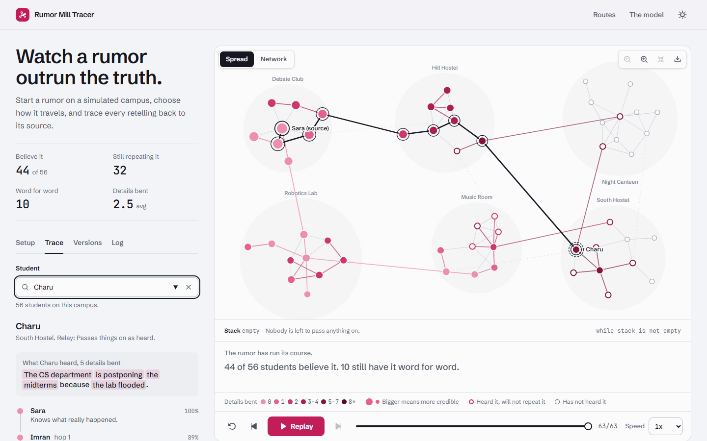

# Campus Rumor Mill Tracer

A simulation of how a rumor travels through a campus social graph. Breadth-first, depth-first, and best-first search are shown as gossip: the story loses credibility and picks up distortions every time it changes hands, and you can trace any student's version back to the source.

Nothing here is real data. The students, friendships, and rumors are generated from a seed.

**Try it live:** [anubhavdey0.github.io/campus-rumor-mill-tracer](https://anubhavdey0.github.io/campus-rumor-mill-tracer/)



## What it shows

Graph traversal is usually taught as "visit every node". Here the order of the visits changes what people end up believing.

- **Broadcast is breadth-first search.** A queue: everyone who hears the rumor tells all of their friends before the next wave starts. Paths stay short, so the story arrives early and mostly intact.
- **A whisper chain is depth-first search.** A stack: each student tells their closest friend who has not heard it, and that friend does the same. Chains run long, so trust drains and details pile up before the chain backs up and tries another branch.
- **Trusted first is best-first search.** A priority queue: whoever holds the most credible version speaks next, so believable chains spread first and weak ones wait their turn.

## The rules

Four rules decide what happens at each retelling.

1. **First version sticks.** A student who has heard the rumor ignores later versions. This is the visited set.
2. **Every hop costs trust.** `credibility = credibility * (1 - decay * (1.5 - closeness))`. Close friends lose less. Skeptics keep only 70% of what arrives.
3. **Retellings bend the story.** With some probability one detail moves one step up its ladder, for example `might postpone` to `is postponing` to `has cancelled` to `has banned`. Embellishers bend twice as often, sticklers never do.
4. **Weak rumors stop.** Below the cutoff a student still hears the rumor but will not repeat it. Every route treats them as a dead end.

The dice for a retelling are seeded by the pair of students involved, not by the order of events, so the same friendship behaves identically on every route. Only the route changes.

One consequence is worth knowing: the dice never decide *who* hears the rumor. Credibility comes from trust and friendships alone, so reach is the same however the dice fall. The dice only decide how the story bends.

## Features

**Watching a run**
- A strip under the map shows the live queue, stack, or priority queue, with the matching line of pseudocode.
- Play, pause, step, or scrub. Changing a dial mid-run keeps your place.
- Zoom with the buttons, ctrl and scroll, or a pinch; drag to pan. Save the map as an image.

**Following the story**
- **Trace:** find any student by name and follow their version back to the source, one retelling at a time, with every changed word highlighted. Compare it with the most believable route the rumor could have taken (Dijkstra's algorithm).
- **Versions:** the rumor's family tree. Every wording in circulation and the one it was bent from. Select one to light up everyone who holds it.
- **Log:** every retelling as text, newest first. Select a line to jump back to that moment.

**Changing the story**
- **Fact-checker:** pick a student who knows the truth. It spreads by the same route and rules but never bends, after a head start you choose. Whoever reaches a student first wins them over.
- **Network view:** every student colored by how far a rumor would spread if they started it, with the bridges (found with Tarjan's algorithm) drawn heavy. Click any friendship to cut it and see what changes.
- Five built-in rumors, or write your own. Free text is scanned for the things gossip exaggerates: hedges, quantities, days, and numbers. Times, dates, and labels such as "Room 204" are left alone.

**Comparing routes**
- **Watch them race:** all three routes on side-by-side maps, released at the same moment.
- A hop-by-hop chart for each route.
- **Was this run typical?** Every route rerun 200 times with different dice, showing how bent the story usually gets and where this run landed.
- **Where does it tip?** Reach for every route as the trust lost per hop rises from 0% to 40%, with a table view.

**Everywhere**
- The whole setup lives in the URL, so any scenario, including cut friendships and the fact-checker, can be shared as a link and replays exactly. Back returns to the previous campus.
- Light, dark, or follow the system. Keyboard shortcuts, reduced-motion support, and text views that mirror the map.
- Heavy work (layout, reruns, sweeps) runs in a Web Worker, so the page never freezes.

## Run it

Requires Node 20.19 or newer (22.12 or newer on the Node 22 line).

```bash
npm install
npm run dev
```

Then open the address Vite prints, usually http://localhost:5173.

| Command | What it does |
| --- | --- |
| `npm run dev` | Start the dev server |
| `npm test` | Run the unit and property tests (Vitest) |
| `npm run test:e2e` | Build, serve, and run the browser tests (Playwright, desktop and phone) |
| `npm run lint` | Check linting and formatting (Biome) |
| `npm run format` | Fix formatting and safe lint issues |
| `npm run typecheck` | Type-check without building |
| `npm run build` | Type-check and build to `dist/` |
| `npm run preview` | Serve the production build locally |

The first time you run the browser tests, install the browser: `npx playwright install chromium`.

Keyboard: `Space` plays and pauses, `Left` and `Right` step one retelling. The shortcuts only apply while the map is on screen, so they never take over scrolling elsewhere on the page.

## Deploying

`.github/workflows/ci.yml` lints, type-checks, and runs both test suites on every push and pull request. On a push to `main` it also builds the site and publishes it to GitHub Pages.

To turn that on, push the repository to GitHub, then in **Settings > Pages** set the source to **GitHub Actions**. The build uses relative paths, so it works at `https://<user>.github.io/<repo>/`. The workflow passes the site address to the build, which adds the link-preview image (`public/og-image.png`) for chats and social posts.

## How the code is laid out

```
src/
  sim/                The model. Plain TypeScript, no UI, fully tested.
    rng.ts            Seeded random numbers and hashing
    campus.ts         Generates students, groups, and weighted friendships
    rumor.ts          Rumor templates, mutation ladders, free-text parsing
    spread.ts         The three routes, the fact-checker, and summaries
    network.ts        Cuts, bridges (Tarjan), best spreaders, believable routes (Dijkstra)
    versions.ts       The family tree of wordings in circulation
    rerun.ts          Reruns with different dice, and the tipping-point sweep
    layout.ts         Force-directed layout for the map
    worker.ts         Background thread for the expensive jobs
    workerClient.ts   Talks to the worker, with a main-thread fallback
    *.test.ts         Unit and property tests
  render/
    renderer.ts       Canvas drawing for the map: spread view, network view, zoom
  components/         React interface: stage, queue strip, panels, comparison, charts
  playback.ts         The playhead, kept outside React so it can run at 60 fps
  urlState.ts         Reads and writes the scenario in the address bar
  theme.ts            Colors, the distortion and reach scales, light and dark mode
e2e/                  Browser tests
```

The simulation never touches the DOM and the renderer never changes simulation state. `simulate()` takes a campus, a rumor, a starting student, a route, the dials, and an optional fact-checker, and returns a trace. Every tick in the trace carries a snapshot of the queue or stack, so everything on screen is a view of that trace at some tick.

## Built with

React, TypeScript, Vite, Tailwind CSS, and the Canvas 2D API. Vitest and Playwright for tests, Biome for linting and formatting.

## License

[MIT](LICENSE)
